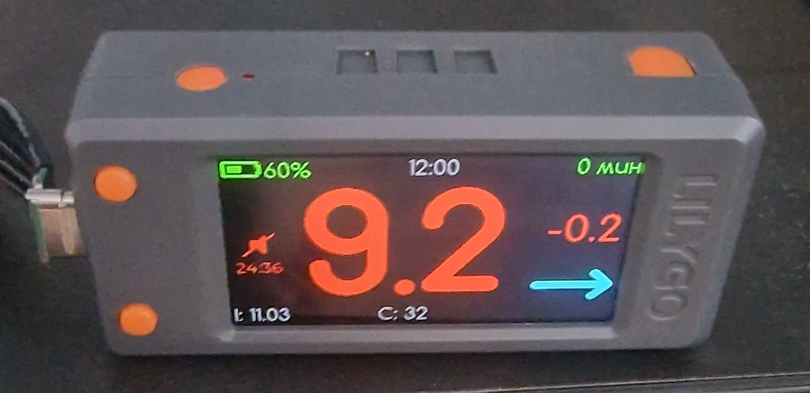
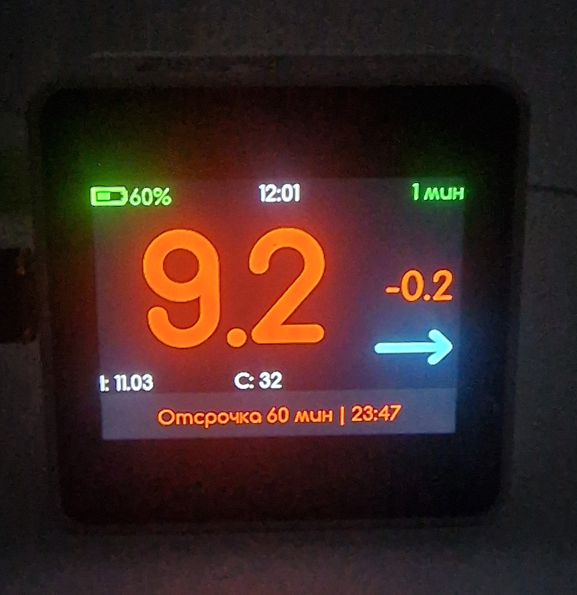

# Nightscout Monitor

<p align="center">
  
  
</p>

Монитор глюкозы для **LilyGO T-Display S3** и **M5Stack CoreS3 / CoreS3 SE**.
Получает данные из Nightscout, показывает показания и тренд, работает как часы
и предупреждает звуком о выходе из заданного уровня глюкозы и потере связи с сервером.

Из настроек Nightscout импортируются
**четыре порога глюкозы**; остальные параметры сохраняются отдельно на каждом
дисплее. Пауза тревог синхронизируется по локальной Wi-Fi сети.

## Поддерживаемые устройства

| Устройство | Экран | Управление | Звук |
| --- | --- | --- | --- | --- |
| LilyGO T-Display S3 | 320 × 170 | Две аппаратные кнопки | Внешний зуммер на GPIO13 |
| M5Stack CoreS3 / CoreS3 SE | 320 × 240 | Сенсорный экран и POWER | Встроенный динамик |

## Возможности

- Основной экран: глюкоза в ммоль/л, стрелки тренда, дельта, возраст измерения,
  время, IOB, COB и заряд Blueberry или помпы.
- Экран часов: крупное время, дата, день недели и краткие данные о глюкозе.
- Цветовые зоны по четырём порогам.
- Пять сохранённых сетей Wi-Fi с выбором приоритета подключения.
- Локальная громкость 0–100%, синхронизированная отсрочка тревог и журнал событий.

## Первое подключение

1. Прошейте устройство, используя окружение своей платы из раздела «Сборка и прошивка».
   При первом запуске откроется экран настройки с QR-кодами.
2. Подключите телефон к сети **`NS-Monitior-Setup`**. Большой QR-код содержит имя
   сети и пароль; их также можно ввести вручную с экрана устройства.
3. Откройте предложенную телефоном страницу входа в сеть. Если она не появилась,
   используйте малый QR-код или адрес **http://192.168.4.1/**.
4. Укажите домашний Wi-Fi, адрес Nightscout и токен, если он требуется. Адрес вводится
   как домен или `хост:порт`, без пути `/api/...`. Выберите часовой пояс, источник
   батареи и громкость.
5. Нажмите **«Сохранить и выйти»**. Устройство перезагрузится и начнёт получать данные.

Локальные настройки доступны сразу и сохраняются без подключения к Nightscout.
При запуске после подключения к Wi-Fi прошивка автоматически запрашивает пороги из Nightscout перед первым
запросом измерений.

После настройки при запуске отображается журнал до первого успешного ответа
Nightscout, затем открывается выбранный основной экран или часы.

## Локальные настройки и синхронизация порогов

Wi-Fi, адрес и токен Nightscout, часовой пояс, летнее время, громкость, источник
батареи и выбранная яркость хранятся в памяти каждого устройства.

Из `/api/v1/status.json` загружаются четыре значения:

| Поле Nightscout | Назначение |
| --- | --- |
| `settings.thresholds.bgLow` | Нижний порог тревоги (красная граница) |
| `settings.thresholds.bgTargetBottom` | Нижний порог предупреждения (жёлтая граница) |
| `settings.thresholds.bgTargetTop` | Верхний порог предупреждения (жёлтая граница) |
| `settings.thresholds.bgHigh` | Верхний порог тревоги (красная граница) |

Nightscout передаёт пороги в mg/dl; прошивка переводит их в ммоль/л.
Пороги запрашиваются **только при запуске**. После успешной загрузки повторных
запросов до следующего перезапуска нет, в том числе при переподключении Wi-Fi.
Если начальная загрузка завершилась ошибкой, повторная попытка выполняется через
**30 секунд**, когда клиент измерений свободен, до первого успешного ответа.
Без сети используются последние полученные серверные границы для того же адреса
Nightscout. До первого успешного получения порогов тревога по уровню глюкозы
не срабатывает; тревога отсутствия свежих измерений работает как прежде.
Флаги тревог и интервалы Snooze
с сервера не импортируются; сохранение серверных порогов не затрагивает локальные параметры.

Пороги загружаются автоматически;
полученные значения выводятся в журнале. 

Для изменения порогов задайте параметры `BG_LOW`, `BG_TARGET_BOTTOM`,
`BG_TARGET_TOP`, `BG_HIGH` на сервере Nightscout, затем перезапустите оба дисплея.
Они получат новые значения при загрузке независимо от модели платы.

## Яркость и выход из настроек

Обычные ступени яркости: **100 → 70 → 30 → 10 → 1% → 100…**.
Выбранная ступень сохраняется после перезапуска.

При открытии настроек экран временно переходит на **100%**. Этот максимум
не записывается вместо выбранной яркости. Новое нажатие любой аппаратной кнопки
перезапускает устройство, после чего восстанавливается сохранённая яркость.
Удержание, которым открыты настройки, не считается новым нажатием: отпустите кнопку.

Для сохранения изменений веб-формы используйте **«Сохранить и выйти»**.
Кнопка **«Выйти без сохранения»** и аппаратные кнопки перезапускают устройство
без сохранения введённых в форму изменений.

Во время звуковой тревоги яркость также временно повышается до 100%.
После прекращения тревоги или включения паузы возвращается выбранный уровень.

## Управление

Следующие действия относятся к обычным экранам. В настройках аппаратные кнопки
используются для перезапуска, как описано выше.

### LilyGO T-Display S3

| Кнопка | Короткое нажатие | Удержание |
| --- | --- | --- |
| Кнопка 1 (GPIO14) | Включить или переключить паузу звука | Переключить основной экран и часы |
| Кнопка 2 (GPIO0 / BOOT) | Изменить яркость | Открыть настройки |
| Обе кнопки | В журнале — вернуться на предыдущий экран | Открыть журнал |

На странице журнала отдельные кнопки прокручивают записи; удержание продолжает прокрутку.

### M5Stack CoreS3 / CoreS3 SE

| Действие | Результат |
| --- | --- |
| Короткое нажатие POWER | Изменить яркость |
| Двойное нажатие POWER | Открыть журнал или вернуться из него |
| Удержание POWER | Открыть настройки |
| Свайп влево или вправо | Переключить основной экран и часы |
| Свайп вверх / вниз в журнале | Перейти к более новым / старым записям |
| Касание нижней экранной кнопки | Включить или переключить паузу звука |
| RST | Перезапустить устройство |

После открытия настроек отпустите POWER: длительное удержание может выключить питание.

## Показания и цветовые зоны

Четыре границы обозначены как **Г1 < Г2 < Г3 < Г4**, значение глюкозы — **G**.
Пороги задаются только на сервере Nightscout и одинаково применяются к цветовым
зонам дисплея и тревогам по уровню глюкозы.

| Зона | Условие | Цвет |
| --- | --- | --- |
| Нижняя красная | G ≤ Г1 | Красный |
| Нижняя жёлтая | Г1 < G ≤ Г2 | Жёлтый |
| Целевая | Г2 < G < Г3 | Зелёный |
| Верхняя жёлтая | Г3 ≤ G < Г4 | Жёлтый |
| Верхняя красная | G ≥ Г4 | Красный |

Крайние границы входят в красную зону.

На основном экране цвет глюкозы определяется зоной, стрелки тренда голубые.
Дельта зелёная при росте больше 0,05 ммоль/л, красная при падении больше 0,05 ммоль/л
по модулю и светло-серая в пределах этого диапазона.

На экране часов время, глюкоза, дельта, возраст и стрелки используют общий цвет зоны.
С **6 полных минут** цвет приглушается; дата и день недели остаются светло-серыми.
При сетевой ошибке сохраняется последнее успешное показание. При отсутствии данных более
**15 минут** основные показатели заменяются прочерками. Часы продолжают показывать время.

### Заряд батареи

Источник выбирается в веб-настройках и сохраняется на устройстве:

| Источник | Поле Nightscout |
| --- | --- |
| Blueberry, по умолчанию | `pump.uploader.battery` |
| Помпа | `pump.pump.battery.percent` |

Показываются проценты выбранного источника. При отсутствии корректных данных
отображается `--%`.
Цвет заряда: 0–15% — красный, 16–35% — жёлтый, выше 35% — зелёный.

## Звуковые тревоги

Настройка звука — **громкость 0–100%**; по умолчанию 31%.
При 0% звук отключён. При ненулевой громкости сигнал звучит
в двух случаях:

- **Красная зона:** корректная глюкоза достигла нижней красной границы или ниже неё,
  либо верхней красной границы или выше неё. Измерение должно быть моложе **10 минут**.
  Жёлтая и зелёная зоны звука не вызывают.
- **Потеря данных:** время с последнего измерения достигло **15 минут**.
  Повторное получение старого измерения не сбрасывает тревогу. До первого измерения
  даётся 15 минут ожидания. Краткое отключение Wi-Fi само по себе не включает сигнал.

Новое свежее измерение прекращает тревогу потери данных; если оно находится
в красной зоне, действует тревога красной зоны.

На T-Display красная зона вызывает три коротких писка, потеря данных — два;
частота внешнего зуммера 2000 Гц. На CoreS3 встроенный динамик воспроизводит
два коротких сигнала 1800 Гц. Сигналы повторяются, пока сохраняется условие тревоги.
Флаги звуковых тревог Nightscout не управляют звуком устройства.

### Индикация звука

| Состояние | T-Display S3 | CoreS3 / SE |
| --- | --- | --- |
| Звук включён, данные моложе 10 минут | Зелёный динамик | Зелёная надпись |
| Нет свежих данных, тревога ещё не активна | Серый динамик | Жёлтая надпись |
| Красная зона | Красный динамик | Красная надпись тревоги |
| Нет свежих данных 15 минут | Жёлто-оранжевый динамик | Красная надпись об отсутствии данных |
| Snooze | Красный перечёркнутый динамик и таймер | Красная надпись и таймер |
| Ошибка звукового устройства | Красный значок предупреждения | Красная надпись ошибки |

При громкости 0% индикатор и кнопка Snooze скрыты. Они также не показываются
на экранах журнала и настроек.

## Общая пауза тревог

Кнопка паузы сразу подавляет обе звуковые тревоги. Паузу можно включить заранее,
при нормальной глюкозе и без интернета. Быстрые повторные нажатия перебирают цикл:

**30 → 60 → 90 → 120 минут → OFF → 30…**

Каждое нажатие отсчитывает выбранную длительность заново. 
Звук возобновляется,
если условие тревоги сохраняется. Смена экрана и потеря Wi-Fi не останавливают
локальную паузу; перезапуск устройства сбрасывает её.

Пауза и отмена передаются через **UDP broadcast, порт 50555** устройствам в одной
подсети с точно совпадающим адресом Nightscout. 

**Логика и формат синхронизации по LAN заимствованы из
[M5_NightscoutMon](https://github.com/mlukasek/M5_NightscoutMon),
автор — Martin Lukasek ([mlukasek](https://github.com/mlukasek)), и адаптированы
для T-Display S3 и CoreS3 / CoreS3 SE.**
Источники: [описание кнопок](https://github.com/mlukasek/M5_NightscoutMon#buttons)
и [исходный код UDP-обмена](https://github.com/mlukasek/M5_NightscoutMon/blob/master/M5_NightscoutMon.ino#L1663).

## Подключение звука T-Display S3

Текущая конфигурация рассчитана на пассивный трёхконтактный модуль зуммера
с управляющим входом **active LOW**:

| Контакт модуля | Подключение |
| --- | --- |
| VCC | 3V3 |
| GND | Общий GND |
| Управляющий вход | GPIO13 |

Тип и полярность другого зуммера задаются в [src/app_constants.h](src/app_constants.h):
`buzzer_active`, `buzzer_module_input`, `buzzer_inactive_high`.
У активного зуммера со встроенным генератором доступны включение и выключение.
На CoreS3 используется встроенный динамик.

## Сборка и прошивка

Проект использует PlatformIO и Arduino. Настройки окружений находятся
в [platformio.ini](platformio.ini); по умолчанию выбран `lilygo-t-display-s3`.

Для LilyGO T-Display S3:

```powershell
pio run -e lilygo-t-display-s3
pio run -e lilygo-t-display-s3 -t upload
```

Для M5Stack CoreS3 / CoreS3 SE:

```powershell
pio run -e m5cores3
pio run -e m5cores3 -t upload
```

Для CoreS3 / SE задано `board_build.arduino.memory_type = qio_qspi`.
Если подключено несколько плат, укажите порт, например `--upload-port COM5`.
Скорость Serial — **115200 бод**:

```powershell
pio device monitor -b 115200
```

После прошивки обновите страницу настроек на телефоне, чтобы загрузить актуальную форму.

## Диагностика

| Ситуация | Что проверить |
| --- | --- |
| Телефон не предлагает открыть настройки | Подключение к `NS-Monitior-Setup`; откройте http://192.168.4.1/ вручную |
| Пороги не обновляются из Nightscout | Перезапуск дисплея после изменения порогов, адрес, токен, домашний Wi-Fi и ошибки `Nightscout status` в журнале |
| Серый динамик на T-Display | Возраст измерения и его метку времени; до начала тревоги это означает отсутствие свежих данных |
| Нет звука | Громкость, действующий Snooze, условие тревоги; на T-Display также подключение и полярность зуммера |
| Snooze не приходит на другой дисплей | Одинаковый адрес Nightscout, общую подсеть, доступность broadcast и синхронизацию часов |
| Вместо чисел прочерки | Наличие данных и возраст последнего измерения; через 15 минут показания скрываются |

Журнал доступен аппаратными кнопками. Информационные сообщения зелёные,
предупреждения жёлтые, ошибки красные. Сообщения журнала и Serial выводятся
на английском. Сброс сохранённых параметров доступен внизу веб-страницы
через **«Сброс устройства…»** и сопровождается перезапуском.

## Для разработчиков

### Исходники и параметры

| Файлы | Назначение |
| --- | --- |
| [src/main.cpp](src/main.cpp) | Запуск, кнопки, экраны и основной цикл |
| [src/captive_portal.cpp](src/captive_portal.cpp), [src/settings.cpp](src/settings.cpp) | Локальная веб-форма и NVS |
| [src/nightscout_session.cpp](src/nightscout_session.cpp), [src/nightscout_client.cpp](src/nightscout_client.cpp) | Фоновая задача сети и чтение Nightscout |
| [src/alarm_state.h](src/alarm_state.h), [src/nightscout_alarm_state.h](src/nightscout_alarm_state.h) | Тревоги, возраст данных и Snooze |
| [src/snooze_lan.cpp](src/snooze_lan.cpp), [src/snooze_protocol.h](src/snooze_protocol.h) | Обмен Snooze по LAN |
| [src/backlight.cpp](src/backlight.cpp), [src/buzzer.cpp](src/buzzer.cpp) | Яркость и внешний зуммер |
| [src/gfx](src/gfx), `src/ui_*`, [src/trend_arrows.h](src/trend_arrows.h) | Драйверы плат, интерфейс и стрелки |
| [include/board_config.h](include/board_config.h), [include/lv_conf.h](include/lv_conf.h) | Пины плат и параметры LVGL |
| [test](test) | Проверки логики и веб-формы |

Константы поведения собраны в [src/app_constants.h](src/app_constants.h):
громкость, ступени яркости, интервалы опроса, Snooze,
параметры зуммера и кнопок. Сохранённые значения NVS имеют приоритет над
`default_*`; изменение заводского значения не перезаписывает уже выбранную настройку.

Измерения читаются через `/api/v2/properties/bgnow,direction,delta,iob,cob,pump`.
После первого ответа плановые запросы в жёлтой и красной зонах идут раз в минуту;
в зелёной зоне — при возрасте измерения больше 5 минут 5 секунд, с интервалом
между попытками не меньше минуты. Возраст на экране обновляется раз в 15 секунд.
DNS/TCP/TLS/HTTP выполняются задачей `NightscoutSession`, результаты передаются
основному циклу через очередь.

Серверная копия порогов хранится в ключах NVS `b0`–`b3`, `boundsOrigin`
и `boundsServer`. Маркер `boundsServer` устанавливается после успешной записи
всех четырёх порогов и адреса источника. Копии без маркера, с чужим адресом
или некорректными значениями не используются. Старые `boundsOverride` и `nsAlarms`
удаляются при сохранении. Ручные поля старой веб-формы отклоняются сервером устройства.

Формат UDP:
`M5_Nightscout SNOOZE: USR=<CRC16>, SnoozeUntil=<Unix seconds>`.
Используется CRC16/MODBUS с начальным значением 0 от точной строки адреса Nightscout;
`SnoozeUntil=0` отменяет паузу. Проверки протокола отклоняют чужой CRC,
повреждённые сообщения и остаток паузы больше суток.

### Проверки

Сборка обеих поддерживаемых плат:

```powershell
pio run -e lilygo-t-display-s3 -e m5cores3
```

Проверка встроенного JavaScript веб-формы без браузерных зависимостей:

```powershell
node test/test_captive_portal.js
```

Логические тесты выполняются через `static_assert`, без подключённого устройства:

```powershell
& "$env:USERPROFILE/.platformio/packages/toolchain-xtensa-esp32s3/bin/xtensa-esp32s3-elf-g++.exe" `
  -std=gnu++14 -Wall -Wextra -Werror -fsyntax-only -Isrc `
  test/test_alarm_state.cpp test/test_nightscout_poll.cpp test/test_nightscout_alarms.cpp `
  test/test_snooze_protocol.cpp test/test_buzzer_volume.cpp test/test_battery_source.cpp `
  test/test_trend_arrows.cpp
```

На самих платах проверяются звук, кнопки, яркость, получение данных, портал
и LAN-обмен Snooze; на CoreS3 дополнительно — сенсорные жесты.
Для проверки настоящей графики на компьютере нужен обычный GCC/MinGW:

```powershell
python scripts/test_ui_render.py --cxx C:/mingw/bin/g++.exe
```
